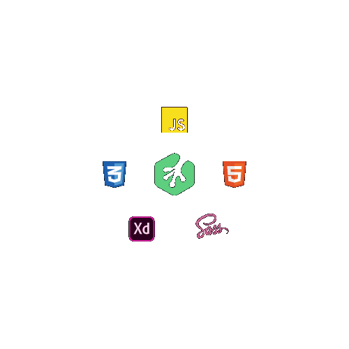

<h2>I'm Navishka Darshana </h2>

<p>Software Engineer | DevOps | Tech Enthusiast</p>

<p>I am Navishka Darshana, a computer science student, an avid IT professional as well as a software engineer.</p>


<!-- [](https://twitter.com/intent/follow?screen_name=Navishka155) -->

<!-- [](https://navishkadarshana.000webhostapp.com/) -->


<p align="left">
<a href="https://www.linkedin.com/in/navishka-darshana-975215195/" target="blank"></a>
<a href="https://www.hackerrank.com/navishkadarshana?hr_r=1" target="blank"></a>
<a href="https://www.youtube.com/c/NavishkaDarshana" target="blank"></a>
</p>


##  Skills  

```javascript
const navishka_darshana = {
    pronouns: "He" | "Him",
    code: ["JavaScript", "TypeScript", "Java", "Python", "SQL", "Shell", "HTML", "CSS"],
    technologies: {
        mobileApp: ["Android App", "React Native"],
        frontEnd: {
            jsFrameworks: ["React", "Angular", "Next.js"],
            css: ["Bootstrap", "Tailwind CSS"],
            java: ["JavaFX"]
        },
        backEnd: {
            js: ["Node.js", "Express", "jQuery", "Next.js"],
            javaFrameworks: ["Spring Boot", "Spring MVC", "Hibernate"]
        },
        databases: ["MongoDB", "MySQL", "Firebase", "PostgreSQL"],
        VCS: ["Git", "GitHub", "Bitbucket"]
    },
    architecture: [
        "Monolithic Architecture", 
        "Microservices", 
        "Single Page Applications", 
        "MVC Architecture", 
        "Layered Architecture", 
        "Client-Server Architecture"
    ],
    tools: [
        "IntelliJ IDEA", "VS Code", "PyCharm", "WebStorm", "NetBeans", "Eclipse", "DataGrip",
        "Android Studio", "Postman", "Adobe XD", "Photoshop", "FileZilla",
        "Docker", "Docker Compose", "Maven", "Gradle", "Nginx", "SonarQube"
    ],
    devOps: [
        "CI/CD Pipelines", 
        "GitHub Actions", 
        "GitLab CI", 
        "AWS ECS (Fargate)", 
        "Amazon ECR", 
        "AWS CodePipeline", 
        "AWS CodeBuild",
        "AWS Secrets Manager", 
        "Dockerization", 
        "Auto Scaling", 
        "Load Balancing", 
        "Infrastructure as Code (IaC)", 
        "Monitoring & Logging", 
        "Linux Server Management", 
        "Nginx Configuration", 
        "SonarQube Code Quality Analysis"
    ],
    cloud: [
        "AWS (ECS, EC2, S3, IAM, Secrets Manager, RDS, CloudWatch, CodePipeline, CodeBuild, Route 53, VPC, ALB, CloudFront)", 
        "Firebase"
    ],
    operatingSystem: ["Windows", "Kali Linux", "Ubuntu", "Linux Mint", "Amazon Linux", "Alpine Linux"],
    other: [
        "Machine Learning", 
        "Artificial Intelligence", 
        "RESTful APIs", 
        "WebSocket", 
        "Moodle Integration", 
        "Active Directory Integration",
        "PDF Generation (PDFShift, Flying Saucer)", 
        "Security Best Practices", 
        "SSL Configuration", 
        "Domain & DNS Setup"
    ]
};
```
